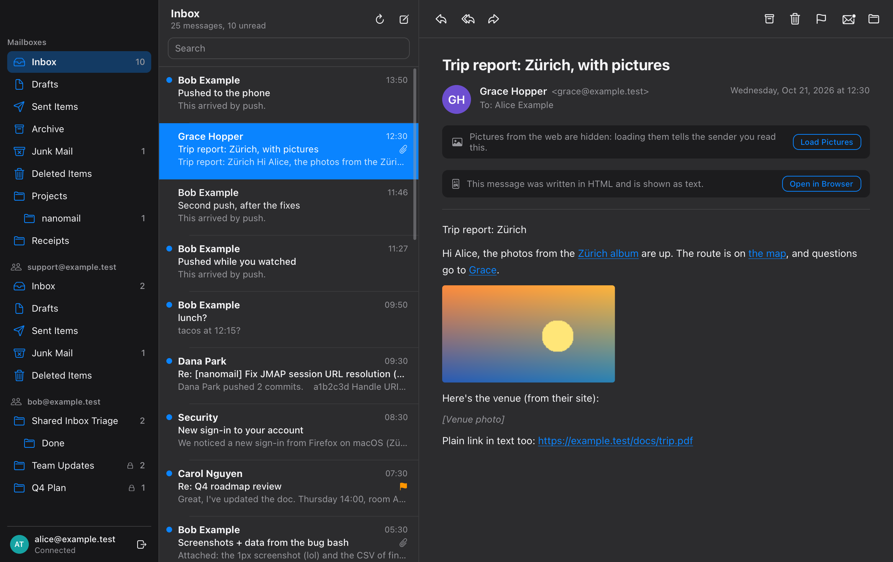

<p align="center">
  
</p>

<h1 align="center">nanoui</h1>

<p align="center">Desktop apps in Zig, with native UI drawn on the GPU or a web frontend.</p>

<p align="center"><sub>Meet Nano. <a href="docs/images/nano-transparent.png">Transparent PNG</a> · <a href="docs/images/nano-paper.png">Original paper illustration</a></sub></p>

<p align="center">Want to see it in use? <a href="https://github.com/justrach/nanoterm"><strong>nanoterm</strong></a> is a terminal with a coding agent, and <a href="https://github.com/justrach/nanomon"><strong>nanomon</strong></a> an activity monitor, both built on nanoui.</p>

<p align="center">
  
  
  
  
  
</p>

<p align="center">
  <a href="#get-started">Get started</a> ·
  <a href="#native-ui">Native UI</a> ·
  <a href="#web-pages">Web pages</a> ·
  <a href="#testing-without-a-window">Testing</a> ·
  <a href="#platforms">Platforms</a> ·
  <a href="#apps">Apps</a> ·
  <a href="#performance">Performance</a> ·
  <a href="#credits">Credits</a>
</p>

<p align="center">
  
</p>

Each window shows one of two kinds of interface:

- **Native UI**, written in Zig alone and drawn by nanoui: no HTML, no
  JavaScript, no webview. It has flexbox layout, text in a glyph atlas,
  animations, and views you can test without a window. On macOS it draws with
  Metal and CoreText, in one instanced draw call per frame.
- **A web page** in the system webview (WKWebView, macOS for now). The
  frontend calls Zig through a JavaScript client generated from your Zig
  types, with TypeScript declarations.

Apps are single binaries. Nothing polls, so an idle app uses no CPU.

## Get started

```sh
git clone --recursive https://github.com/justrach/nanoui
cd nanoui
zig build run-gallery    # the native UI tour
zig build run-hello      # the webview example
zig build test           # unit and widget tests
```

You need Zig 0.17.0, plus the macOS SDK on a Mac (Xcode or the Command Line
Tools). Linux apps need GTK 3 at run time and nothing at build time.

`--recursive` also fetches the apps, which live in their own repositories as
submodules under `apps/`. To fetch them after a plain clone, run
`git submodule update --init`.

### A new app: `nui`

`nui` makes an app that builds, and checks it without opening a window,
for people and for coding agents alike. It never asks anything, and every
command takes `--json`.

```sh
nui start my-app          # build.zig, a view, its test and an AGENTS.md; then it builds
cd my-app
nui test                  # the view's tests, rendered offscreen
nui snapshot --out shot.png --script "click:Increment"   # the app as a PNG, no window
nui run                   # its window
nui doctor                # Zig 0.17, and GTK 3 on Linux
```

Each release has `nui` for macOS, Linux and Windows; `zig build nui` builds
it into `zig-out/bin`. `nui start` pins nanoui at the release `nui` came
with (`--nanoui REF` for another, `--local PATH` for a checkout). The app's
`AGENTS.md` tells an agent the commands and rules: check the look with
`nui snapshot`, the behavior with `ui.Tester`.

To add nanoui to a project of your own instead:

```sh
zig fetch --save git+https://github.com/justrach/nanoui#v0.5.0
```

Releases are tagged `vMAJOR.MINOR.PATCH`, as mygo's are, and each is listed
under [Releases](https://github.com/justrach/nanoui/releases) with what
changed. While nanoui is 0.x, a minor release may change the API; a patch
release won't.

## Native UI

```zig
const Counter = struct {
    n: i64 = 0,

    fn view(s: *Counter, c: *ui.Context) void {
        const col = ui.div(c).column().sizeFull().center().gap(16);
        defer col.end();
        ui.textf(c, .{ .size = 56, .weight = .bold }, "{d}", .{s.n});
        if (ui.button(c, "Increment", .{ .variant = .primary }).clicked) s.n += 1;
    }
};

pub fn main(init: std.process.Init) !void {
    const app = try nanoui.App.create(init, .{ .name = "Counter" });
    defer app.destroy();
    var state: Counter = .{};
    _ = try app.newWindow(.{ .title = "Counter", .content = .{ .view = .init(&state, Counter.view) } });
    try app.run();
}
```

<p align="center">
  
  <br><sub>The gallery example, <code>zig build run-gallery</code>.</sub>
</p>

Views are immediate mode: a function of your state, run on every event.
Widgets answer from the previous frame's layout. When an interaction changes
state, the frame is built again before it's drawn, so the screen never lags
the state.

<details>
<summary>What's in the toolkit</summary>

- **Layout:** rows, columns, cards and scroll views, with flexbox grow,
  shrink, absolute placement, and maximum sizes.
- **Elements:** GPUI-style method chains, such as
  `ui.div(c).row().gap(8).bg(...)`.
- **Lists:** a virtualized list (`ui.list`) that builds only the rows in view.
- **Text:** wrapping, monospace, weights and rich spans, with text that can
  be selected and copied like a terminal's; lines too long for their box
  end in an ellipsis or fade out (`.truncate`); fonts an app bundles are
  found by family like installed ones (`ui.registerFont`).
- **Controls:** buttons, checkboxes, toggles, sliders, progress bars,
  segmented controls, badges, and text fields. Input methods that compose
  text (Chinese, Japanese) work in them on macOS and Linux only so far; see
  the platforms table.
- **Images:** pictures decoded once and packed into an atlas.
- **SVG:** icons and marks from SVG files (`ui.svg`), drawn by nanoui at
  the screen's density on every platform and tinted to follow the theme:
  paths, shapes, fills, strokes, transforms and inherited styles.
- **Look:** light and dark themes that follow the system, eased animations,
  Gaussian shadows, and Liquid Glass.
- **Pointer:** hover that follows ancestry as CSS's `:hover` does, double
  clicks, and pointer tracking for graphs (`c.wants_moves`).

</details>

### Liquid Glass

`.glass(.{})` fills a box with Liquid Glass, the material of macOS 26 and
later, in place of a background. Whatever was painted under the box shows
through it: frosted, bent near its edges as through the rim of a lens, and
lit along a hairline rim. That includes content scrolling under a toolbar
placed over it with `absolute()`.

```zig
const bar = ui.div(c).absolute().offset(20, 20).w(420).h(56).row().itemsCenter().px(16).rounded(28).glass(.{});
defer bar.end();
ui.text(c, "On glass", .{ .weight = .semibold });
ui.spacer(c);
// A prominent button: glass tinted with the accent.
const tap = ui.div(c).px(16).py(8).rounded(16).glass(.{ .tint = th.accent }).control();
defer tap.end();
ui.text(c, "Tap", .{ .color = th.accent_text });
```

Regular glass frosts and lightens what shows through, or darkens it in dark
mode, so text on it reads over anything. `.style = .clear` barely frosts it,
for glass over photos and video. nanoui draws the glass itself, after mygo's
glass plugin and its measurements of AppKit's `NSGlassEffectView`. Each pane
averages and blurs what's under it, then shades it on the GPU, and the CPU
renderer computes the same pixels. It looks the same on Linux and Windows,
and a test checks the two renderers agree.

<p align="center">
  
  <br><sub>The gallery's Glass page.</sub>
</p>

### Motion

`ui.motion` animates boxes the way gpui-motion does: every frame, you say
where a box should be, and motion takes it there.

- **Transitions:** a spring, or a tween with an easing.
- **Interruptible:** a target that changes midway is taken from where the box
  is, and a spring keeps its speed.
- **Presence:** boxes enter from `initial`, and leave to `exit` before
  they're removed.
- **Gestures:** `hover` and `press` are targets too.
- **Lists:** items can be staggered.
- **Layout animation:** boxes the layout moves glide to their new place.
- **Shared elements:** boxes that share a key glide across parents (`share`).
- **Drag and snap:** a box follows the pointer, then springs to a point.
- **Scroll-linked values:** a scroller's progress drives another number.
- **Animated text:** letters or words enter, staggered.
- **Keyframes:** they loop, or play there and back.

Motion keeps its state in the frame's context, by box, so there are no
objects to hold. It draws frames only while something moves, and jumps
straight to the end when the system asks for reduced motion.

```zig
const f = ui.motion.frame(c, .{
    .target = .{ .width = if (open) 320 else 180, .background = if (open) th.accent else th.surface },
    .initial = .{ .y = 12, .opacity = 0 },
    .press = .{ .scale = 0.96 },
    .transition = .{ .spring = ui.motion.Spring.bouncy },
});
const card = ui.div(c).p(16).control().motion(f);
defer card.end();
if (card.clicked()) open = !open;

// A toast that comes and goes: drawn while it shows, and while it leaves.
if (ui.motion.present(c, "toast", saved, .{ .initial = .{ .y = 24, .opacity = 0 }, .exit = .{ .opacity = 0 } })) |t| {
    const toast = ui.div(c).px(16).py(12).rounded(12).bg(th.text).motion(t);
    defer toast.end();
    ui.text(c, "Saved", .{ .color = th.background });
}
```

<p align="center">
  
  <br><sub>The gallery's Motion page.</sub>
</p>

### Kit

`nanoui.kit` is a set of components after GPUI Kit, drawn by nanoui and
moved by `ui.motion`:

- **Buttons** in its variants (primary, danger, ghost, outline, link, …) and
  sizes, with icons, loading and tooltips.
- **Display:** tags, badges, avatars and stacks of them, alerts, skeletons,
  spinners, progress bars and rings.
- **Overlays:** tooltips, popovers, menus, dialogs, sheets and toasts. They
  open on layers over the page, go where they fit, and close on Escape or a
  click elsewhere.
- **Navigation:** tabs whose marker slides, breadcrumbs, pagination, and
  accordions that open to their content's height.
- **Forms:** radio groups, selects you can move through with the arrow keys,
  number inputs, and labelled fields with hints and errors.

```zig
const kit = nanoui.kit;

if (kit.button(c, "Delete", .{ .variant = .danger, .icon = "trash" }).clicked) confirm = true;
if (kit.dialog(c, "confirm", &confirm, .{ .title = "Delete project?", .ok = "Delete", .ok_variant = .danger })) |d| {
    ui.text(c, "Its files and history go too.", .{});
    if (d.end() == .ok) toaster.push(.{ .status = .danger, .title = "Deleted" });
}
_ = kit.tabs(c, &.{ "Overview", "Activity", "Settings" }, &tab, .{ .variant = .segmented });
toaster.view(c); // last: toasts over everything
```

Overlays are made of two new box properties: `layer` draws a box above the
page and unclipped, and `fixed` places it from the window's corner.
`Context.state` keeps a widget's small state between frames.

<p align="center">
  
  <br><sub>The gallery's Kit page.</sub>
</p>

## Web pages

```zig
const Greeter = struct {
    pub const nanoui_params = .{ .greet = .{"name"} };

    pub fn greet(_: *Greeter, call: *nanoui.Call, name: []const u8) ![]const u8 {
        return std.fmt.allocPrint(call.arena, "Hello, {s}!", .{name});
    }
};

const Tick = nanoui.Event("tick", struct { uptime: u64 });

// in main:
try app.bind(&greeter);
try app.registerEvent(Tick);
_ = try app.newWindow(.{ .title = "Hello", .content = .{ .page = .{ .url = "/", .assets = &assets } } });
```

```js
import { Greeter, onTick } from "/nanoui.js"; // generated, served by the app

document.body.textContent = await Greeter.greet("Ada");
onTick(({ uptime }) => console.log(uptime));
```

`zig build gen` writes `nanoui.d.ts`:

```ts
export declare const Greeter: { greet(name: string): Promise<string> };
export declare function onTick(listener: (payload: TickPayload) => void): () => void;
```

Methods may return error unions; an error rejects the page's promise with
the error's name. Assets are served from the `nanoui://localhost/` scheme.
Elements styled `--app-region: drag` move frameless windows.

## Testing without a window

```zig
var t: ui.Tester = undefined;
try t.init(gpa, .init(&state, Counter.view), .{});
defer t.deinit();
try t.clickText("Increment");
try std.testing.expect(t.hasText("1"));
try t.screenshot("/tmp/counter.png"); // rendered offscreen by the Metal renderer
```

The real apps run headless too:

```sh
zig-out/bin/gallery --nanoui-snapshot=shot.png --nanoui-script="click:Tasks;type:Hi;key:enter"
zig-out/bin/hello --nanoui-eval='nanoui.call("Greeter.greet","Ada").then(v => { nanoui.log(v); nanoui.window.close() })'
```

`--nanoui-wait=SECONDS` runs the event loop first, drawing the view as it
goes, so what an app loads as it draws (pictures, a map's tiles, replies)
is there in the snapshot.

## Platforms

nanoui loads what each platform has instead of linking it, so every platform
builds from any machine (iOS from a Mac with Xcode, for its SDK; Android with
Android's SDK and NDK). On a Mac, `zig build -Dtarget=x86_64-linux-gnu` or
`-Dtarget=x86_64-windows-gnu` makes a Linux or Windows binary.

| | macOS | iOS | Android | Linux | Windows |
|---|---|---|---|---|---|
| windows, input, timers | AppKit | UIKit: screens over each other, touch, keyboards | NativeActivity: screens over each other, touch, keyboards, Back | GTK 4, else GTK 3 (loaded with `dlopen`) | Win32 |
| text | CoreText | CoreText | nanoui's TrueType reader, Android's fonts | nanoui's TrueType reader (`src/ui/tt/`) | the same |
| rendering | Metal | Metal | OpenGL ES 3; CPU without it | OpenGL 3.3 in a GtkGLArea; CPU (`src/ui/raster.zig`) without one | CPU, shown by Direct3D 11 (a DXGI flip swap chain; GDI without it) |
| icons | SF Symbols | SF Symbols | line icons drawn by nanoui (`src/ui/icons.zig`) | the same | the same |
| SVG (`ui.svg`) | drawn by nanoui (`src/ui/svg.zig`) | the same | the same | the same | the same |
| pages (webview) | WKWebView | not yet | not yet | not yet | not yet |
| menus | the menu bar | a keyboard's shortcuts | a keyboard's shortcuts | accelerators | accelerators |
| HTTP (`nanoui.http`) | NSURLSession | NSURLSession | http-zig, names looked up by Android | [http-zig](https://github.com/justrach/http-zig): HTTP/2 over TLS, a thread per request | the same |
| input methods that compose text | NSTextInputClient: marked text, the edit menu | not yet: a software keyboard types keys | not yet: a software keyboard types keys | GTK's input method, its preedit | not yet: only what arrives as `WM_CHAR` |
| accessibility | VoiceOver: buttons, checkboxes, toggles, sliders, radio buttons, text fields (not static text or `nanoui.kit`) | not yet | not yet | not yet | not yet |

The CPU renderer matches the Metal one pixel for pixel, and a test compares
them; others compare the OpenGL renderer with the CPU one, with OpenGL 3.3
and with OpenGL ES 3, in a context without a window. `NANOUI_RENDERER=cpu` draws on the CPU where OpenGL is. `zig build test -Dportable=true` runs the Linux and Windows text and
renderer on a Mac. Linux is also tested in a container
(`tools/linux.Dockerfile`: GTK 3 and 4, fonts and a virtual display).

On Linux nanoui loads GTK 4 when it's installed and GTK 3 otherwise;
`NANOUI_GTK=3` asks for GTK 3. Both work the same: GTK 4's event
controllers, draw function, clipboard and dialogs stand in for GTK 3's
event signals and waiting calls (`src/linux/surface_gtk4.zig`). On Windows,
frames reach the screen through a Direct3D 11 device (hardware, else WARP)
and a flip-sequential swap chain, so resizing stays smooth and content
stays anchored (`src/windows/d3d.zig`).

### iOS

<p align="center"></p>

The gallery on an iPhone ([MP4](docs/images/ios-gallery.mp4)). It's the same
Zig view as on the Mac. When the window is narrow it shows its pages as a list
and pushes each one in. The app played this itself:

```sh
xcrun simctl launch booted dev.nanoui.gallery "--nanoui-play=tap:Tasks;tap:Something to do;type:Record a demo;tap:Add"
xcrun simctl io booted recordVideo demo.mov
```

`--nanoui-play` takes the same steps as `--nanoui-script` (tap, type, key,
scroll, wait) and plays them in the running app at a person's pace, with a
dot where each finger lands. It works on macOS too. The Simulator can record
its screen but can't tap, so this is how you make demo videos.

Native UI runs on iOS with the Mac's renderer and text, Metal and
CoreText; `src/ios/` puts them on UIKit. The first window fills the
screen, and windows shown after it cover it until they close or hide; a
window over another needs its own way to close (no swipe down). A finger
is the pointer: it presses and drags, and scrolls what it moves up or
down over, flinging as iOS's scroll views do. Two fingers pinch: their
spread and movement come to the view as `input.zoom` and `input.pan` (a
trackpad's pinch does on the Mac). A hardware keyboard's
keys and shortcuts work as on the Mac, and a focused text field brings
up the software keyboard. Views are laid out inside the safe area,
clear of the status bar, the home indicator and the keyboard; a window
made with `.full_bleed = true` spans the screen and keeps its content
clear itself with `ui.div(c).safeArea()`.

```sh
zig build $(sh tools/ios/zig-lib.sh) -Dtarget=aarch64-ios-simulator               # zig-out/ios/Counter.app, Gallery.app
zig build $(sh tools/ios/zig-lib.sh) run-gallery -Dtarget=aarch64-ios-simulator   # in the booted Simulator
zig build $(sh tools/ios/zig-lib.sh) run-gallery -Dtarget=aarch64-ios-simulator --watch   # again on every save
```

With `--watch`, each save builds the app, installs it and launches it
again in the Simulator in a few seconds, its output in the same terminal.
A release build (`-Doptimize=ReleaseSmall`) is stripped of its local
symbols as it is bundled: the counter is about 300 KB, the gallery about
500 KB, the renderer, text and widgets in them.

You need Xcode for the iOS SDK. Zig 0.17.0's std can't build programs for
iOS as it ships: it takes iOS for a system that can replace its process
image (`std.process.can_replace`). `tools/ios/zig-lib.sh` makes Zig's lib
folder again out of links to it, with that one line fixed, and prints the
`--zig-lib` flag that uses it (nothing, once Zig is fixed), which goes
first after `zig build`.

`-Dtarget=aarch64-ios` builds for devices: sign the app with your team
(Xcode, or `codesign` and a provisioning profile) and install it with
`xcrun devicectl`. Zig compiles a device's program and Apple's linker
(`xcrun clang`) links it: an iPhone refuses a program Zig 0.17.0 links,
before it runs and without a crash report. An app bundles itself in its
own build.zig:

```zig
const bundle = @import("nanoui").ios.app(b, exe, .{ .name = "Notes", .id = "com.example.notes" });
```

An app that makes its own bundle takes its program from
`ios.executable(b, exe)`.

Zig 0.17 makes iOS 18 the lowest an app runs on unless the target names
one, and the app's Info.plist follows it. nanoui runs on iOS 15 and
later: `-Dtarget=aarch64-ios.15.0` (or `aarch64-ios.15.0-simulator`)
reaches those devices.

Not on iOS yet: pages, input methods that compose text (Japanese,
Chinese), autocorrect, VoiceOver, keys repeating while held, and more than
one window on an iPad.

### Android

<p align="center"></p>

Native UI runs on Android with Linux's text and renderer, nanoui's TrueType
reader on Android's fonts and OpenGL ES 3 (or the CPU), on the NDK's
NativeActivity (`src/android/`). There's no Java of nanoui's own: the app's
`main` runs on a thread of its own with a looper, and Java's classes are
called through JNI where Android has no C interface (the clipboard, links,
dialogs, the software keyboard, the insets). As on iOS, the first window
fills the screen and windows shown after it cover it; a finger presses,
scrolls and flings, two pinch, and views are laid out clear of the bars,
the cutout and the keyboard. Back is Escape for the top window's view
first (a menu, a sheet or a page closes), then closes the top window, and
on the last one sends the app to the background. A mouse hovers, clicks
and scrolls; dark mode, rotation and density follow the system.

```sh
zig build -Dtarget=aarch64-linux-android               # zig-out/android/Counter.apk, Gallery.apk
sh tools/android/emulator.sh                           # an emulator without a window
zig build run-gallery -Dtarget=aarch64-linux-android   # installed and run there (or on a phone), its log here
```

What you need, an app's build.zig, and what isn't there yet:
[docs/android.md](docs/android.md).

## Apps

<table>
  <tr>
    <td width="50%" valign="top">
      <a href="https://github.com/justrach/nanoterm"></a>
      <p><a href="https://github.com/justrach/nanoterm"><strong>nanoterm</strong></a>: a terminal of blocks, in the manner of Warp, with a coding agent (graff or Claude Code) over ACP. It has native visuals, a ⌘P launcher, and SSH sessions where the agent works on the remote host.</p>
    </td>
    <td width="50%" valign="top">
      <a href="https://github.com/justrach/nanomon"></a>
      <p><a href="https://github.com/justrach/nanomon"><strong>nanomon</strong></a>: an activity monitor in Codegraff colors, with cell graphs of CPU, memory, GPU, disk and network. You can quit several processes at once, and a graff bubble suggests what to quit.</p>
    </td>
  </tr>
  <tr>
    <td width="50%" valign="top">
      <a href="https://github.com/justrach/nanostudio"></a>
      <p><a href="https://github.com/justrach/nanostudio"><strong>nanostudio</strong></a>: a screen recorder and editor. It records a display or a window with its sound, then zooms where you clicked. You can trim, speed up and dress the take, and export it. Every frame, preview and export alike, is a nanoui view.</p>
    </td>
    <td width="50%" valign="top">
      <a href="https://github.com/justrach/nanofly"></a>
      <p><a href="https://github.com/justrach/nanofly"><strong>nanofly</strong></a>: flights, live, on a map, for iPhone (and the Mac), after Flighty. It finds a flight's route, follows it from open ADS-B data, and says when it lands by each airport's clock, with the weather there. Its map, drawn by <code>ui.canvas</code>, has the night's side, the weather's radar and the planes around; you can pinch it, and its card is a sheet of Liquid Glass you drag between three heights.</p>
    </td>
  </tr>
  <tr>
    <td width="50%" valign="top">
      <a href="https://github.com/gstohl/nanomail"></a>
      <p><a href="https://github.com/gstohl/nanomail"><strong>nanomail</strong></a>: a JMAP mail client for macOS and iOS. It shows rich mail with links and pictures, loading pictures from the web only when you ask. New mail arrives by push, and mailboxes others share with you appear with what you may do in them. It signs in with a password, a token, or OAuth in the browser.</p>
    </td>
    <td width="50%" valign="top"></td>
  </tr>
</table>

Download them for macOS:
[nanoterm](https://github.com/justrach/nanoterm/releases/latest/download/nanoterm-macos-arm64.dmg) ·
[nanomon](https://github.com/justrach/nanomon/releases/latest/download/nanomon-macos-arm64.dmg) ·
[nanostudio](https://github.com/justrach/nanostudio/releases/latest/download/nanostudio-macos-arm64.dmg).
nanomail builds from source for now (`zig build`; its README has iOS).

They live in `apps/` as submodules, and each also builds on its own, fetching
nanoui pinned by commit. To build one against the nanoui next to it, with
your changes, use `--fork`: `cd apps/nanomon && zig build run --fork=../..`.

## Performance

Performance is measured headless with [`hillclimb/`](hillclimb/README.md):
the same scenes rendered through each framework's own frames and offscreen
Metal renderer, on an Apple M3 Ultra. The figures are medians per frame in
milliseconds; lower is better.

| scene | frame CPU nanoui | frame CPU mygo | GPU nanoui | GPU mygo |
|---|---:|---:|---:|---:|
| boxes (600 shadowed boxes) | 0.061 | 0.301 | 0.140 | 1.616 |
| text (300 changing labels) | 0.108 | 0.418 | 0.065 | 0.056 |
| scroll (1000-row column) | 0.315 | 2.076 | 0.055 | 0.122 |
| list (100 000-row virtual list) | 0.060 | 0.367 | 0.046 | 0.045 |
| dashboard (12 cards) | 0.015 | 0.087 | 0.098 | 0.295 |

Release binaries are about 0.7 MB for nanoui and 11.8 MB for mygo. IPC (5000
sequential calls from the page to native code) took 493 ms with nanoui and
528 ms with mygo.

### Build times

A counter app each, from empty build caches, on the same M3 Ultra
(`sh tools/buildperf.sh` measures it again: mygo's
`examples/counter-native` with Go 1.27.1, nanoui's from `nui start` with
Zig 0.17.0; network fetches aren't timed):

| | mygo | nanoui |
|---|---:|---:|
| cold build | 4.4 s | 6.3 s (a second app, Zig's global cache warm: 4.8 s) |
| rebuild, nothing changed | 0.28 s | 0.12 s |
| rebuild after a one-line edit | 0.55 s | 2.2 s |
| build cache on disk | 182 MB | 97 MB |
| program | 14 MB | 4 MB Debug, 0.7 MB ReleaseFast (11 s), 0.4 MB ReleaseSmall (6.7 s) |

Zig compiles the app and nanoui as one unit, so an edit rebuilds the
whole of it where Go rebuilds one package: that's where mygo is faster.
Cold builds are close, nothing-changed rebuilds faster, and the disk a
project costs is about half.

## Development

```sh
zig build lines                                                       # the 600-line limit, enforced
zig build test-bin -Dtarget=aarch64-linux-gnu --prefix zig-out/linux  # Linux tests, for the container
cd hillclimb && zig build run -- --label "change"                     # benchmarks against mygo and history
sh tools/version.sh 0.2.1                                             # set the version for a release
```

To release, set the version, commit, and push its tag (`git tag v0.2.1 &&
git push origin v0.2.1`). The release workflow checks that the tag matches
`build.zig.zon`, runs the tests, and opens the GitHub release.

Rules for working here, by hand or with an agent, are in
[AGENTS.md](AGENTS.md).

nanoui is a subset of what full frameworks offer. Pages work only on macOS so
far, accessibility reaches only macOS's built-in controls, and there are no
notifications, channels or plugins yet,
and bundling only for iOS and Android. Apps update themselves from GitHub releases on macOS
(`nanoui.Updater`). Bound methods run on the main thread.

## License

nanoui is licensed under the [MIT License](LICENSE). Material from mygo (MIT),
GPUI (Apache 2.0), gpui-motion (MIT) and GPUI Kit (Apache 2.0) keeps its own
notices; see
[third-party notices](THIRD_PARTY_NOTICES.md).

## Credits

nanoui stands on the shoulders of these projects:

- **[mygo](https://github.com/egoist/mygo)** by [egoist](https://github.com/egoist):
  nanoui began as a port of its core to Zig, and keeps its architecture. That
  means:
  - the Objective-C runtime called directly, with runtime classes for
    delegates;
  - a batched outbox with one evaluation per main-loop turn;
  - events held until the page is ready;
  - a generated, typed client;
  - native UI drawn by the framework;
  - Liquid Glass drawn by its own renderers, ported from mygo's glass plugin.
- **[GPUI](https://github.com/zed-industries/zed/tree/main/crates/gpui)** by
  [Zed Industries](https://zed.dev). From GPUI, nanoui takes:
  - elements styled by method chains;
  - the virtualized `uniform_list`;
  - layouts cached across frames, with glyphs rasterized once into an atlas;
  - Gaussian shadows;
  - its general idea of a fast, GPU-drawn native UI.
- **[gpui-motion](https://github.com/1bye/gpui-motion)** by
  [1keep](https://github.com/1bye): `ui.motion` follows its model and API.
  That covers interruptible targets, presence, keyframes, stagger, layout
  animation, its exact springs and its easing curves.
- **[GPUI Kit](https://github.com/longbridge/gpui-component)** by
  [Longbridge](https://github.com/longbridge): `nanoui.kit` follows its
  components, their variants and their names.

<p align="center"><sub>Built in Zig 0.17 · <a href="AGENTS.md">AGENTS.md</a> · <a href="hillclimb/README.md">benchmarks</a> · <a href="LICENSE">MIT</a> · <a href="THIRD_PARTY_NOTICES.md">third-party notices</a></sub></p>
